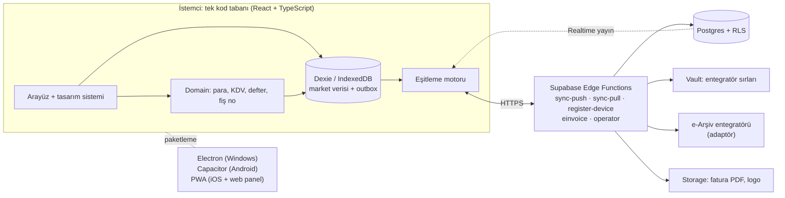

# Market Kasa v2 — Tasarım Dokümanı

- **Durum:** Onaylandı (2026-10-28)
- **Tarih:** 2026-10-28
- **Dal:** `v2` (canlı uygulama geçiş gününe kadar `main` dalında çalışmaya devam eder)

---

## 1. Anlaşma özeti

- **Ne:** Sıfırdan yeni mimari ve yeni tasarım sistemiyle, internetsiz çalışan, çok kiracılı (birden çok market) kasa ve arka ofis uygulaması.
- **Neden:** v1'de güvenlik açıkları, veri kaybı ve tutarsız bir arayüz var. Hedef hem kendi marketimizde güvenle kullanmak hem de başka marketlere vermek.
- **Kim için:**
  - **Market sahibi:** yönetim ve raporlar, uzaktan web panelinden.
  - **Kasiyer:** hızlı satış.
  - **Stok personeli:** sayım ve mal kabul.
  - **Operatör (Kaan):** market hesaplarını açar ve kapatır.
- **Cihazlar:** Windows (Electron), Android (Capacitor), iPhone ve iPad (PWA), web paneli.
- **Kısıtlar:**
  - Satış, iade, veresiye, stok ve kasada yeni ürün ekleme internetsiz çalışır; internet gelince otomatik eşitlenir.
  - Fatura e-Arşiv entegratörüyle kesilir.
  - Fiş yazdırma ayarlardan açılıp kapanır.
  - Ödeme uygulamanın dışında alınır; market hesabını operatör açar.
- **Bu sürümde yok:** Uygulama içi ödeme veya abonelik, yazarkasa (ÖKC) entegrasyonu, para çekmecesi, terazi ve kg ile satış, çok şubeli zincir yönetimi.

## 2. Varsayımlar (onaylandı)

1. **Dil:** Arayüz Türkçe. Çok dil altyapısı hazır olur, ama ilk sürümde yalnızca Türkçe.
2. **Ölçek:** Market başına en fazla 20.000 ürün, günde 1.000 satış, 5 cihaz. İlk yıl en fazla 100 market.
3. **Güvenlik:**
   - Sahip e-posta ve şifreyle girer; personel kayıtlı cihazda PIN ile geçiş yapar.
   - PIN'ler hash'lenir.
   - Her marketin verisi sunucuda ayrı tutulur ve yetkiler sunucuda da kontrol edilir.
   - İptal, iade ve fiyat değişikliği iz kaydına düşer.
4. **Güvenilirlik:**
   - Satış önce cihaza, sonra sunucuya yazılır; hiçbir satış kaybolmaz.
   - Stok ve bakiye hareketlerden hesaplanır.
   - Sunucuda günlük yedek alınır.
5. **Taşıma:** Kurşunlu Market'in v1 verisi (ürün, müşteri, veresiye hareketleri, satış geçmişi) tek seferde aktarılır.
6. **Fiş:** Termal yazıcıya işletim sistemi sürücüsüyle basılır. PDF ve WhatsApp paylaşımı her zaman açıktır.
7. **Lisans:** Market hesabında aktif/pasif durumu ve bitiş tarihi tutulur. Süre dolunca uyarı gelir, sonra uygulama salt-okunur hale geçer; veri kaybolmaz.
8. **İnternetsiz iki kasa:** İnternet yokken aynı marketteki iki kasa birbirinin satışını görmez; internet gelince eşitlenir. LAN WebSocket kaldırılır.
9. **iOS:** PWA ile sunulur. Yerel iOS uygulaması sonraya kalır.
10. **Kod:**
    - TypeScript, testler ve CI kapıları.
    - Sürüm numarası tek kaynaktan gelir.
    - README İngilizce olur.

## 3. Karar günlüğü

| # | Karar | Değerlendirilen seçenekler | Neden |
|---|---|---|---|
| K1 | Hem canlı market hem çok kiracılı ürün | Yalnızca kendi market; portföy projesi | Kullanıcının hedefi: Kurşunlu Market'te kullanmak ve diğer marketlere vermek. |
| K2 | Windows, Android, iOS (PWA) ve web paneli | Daha dar bir platform seti | Kasa, reyon ve uzaktan yönetim ihtiyaçlarının hepsi gerçek. |
| K3 | Tam çevrimdışı | Yalnızca satış çevrimdışı; internet şart | Kasada barkodu bulunmayan ürün satış sırasında eklenir; bunun da internetsiz çalışması gerekir. Yalnızca eklemeye dayanan veri modeli çakışmayı ortadan kaldırır. |
| K4 | Donanım olarak yalnızca barkod okuyucu; fiş yazdırma ayardan | Para çekmecesi, terazi | Kullanıcının seçimi. Gerekmeyen şeyi yapmama (YAGNI). Veri modeli ondalıklı miktarı yine de destekler (terazi sonra eklenebilir). |
| K5 | Fatura e-Arşiv özel entegratörüyle, PDF olarak | Yazarkasa ayrı kalır (bilgi fişi); ÖKC entegrasyonu | Kullanıcı ayrı kâğıt fatura tutmak istemiyor. Yasal geçerlilik için faturanın GİB'e kaydı şart. |
| K6 | Ödeme uygulama dışında; marketi operatör açar | Kendi kaydı ve sonradan ödeme; abonelik | Kullanıcı ödemeyi elden alıyor. |
| K7 | Üç tasarım yönü için taslak; seçim taslaklardan sonra | Yalnızca koyu kasa modu | Zevk sözle değil görerek seçilir. Koyu tema, her yönün bir varyantı olarak gelir. |
| K8 | Mimari A: Supabase ve kendi yazılan eşitleme | B: Supabase + PowerSync; C: Firebase | Her şey kontrolümüzde, raporlar SQL ile yazılır, ek ücretli servis yok, Supabase zaten biliniyor. Risk eşitleme kodu; ekleme tabanlı model bu riski küçültür. |
| K9 | Aynı repo, `v2` dalı | Yeni repo | Geçmiş, CI ve sürüm altyapısı korunur. Geçiş günü `v2`, `main` ile birleştirilir. |
| K10 | iOS için PWA | Capacitor iOS | Yerel iOS uygulaması Mac ve Apple geliştirici hesabı ister; sonraya kalır. |
| K11 | LAN eşitleme kaldırılır | LAN WebSocket'i güvenli hale getirmek | Kimliksiz LAN sunucusu güvenlik açığı. Sunucu eşitlemesi yeterli. |
| K12 | Arayüz yönü: sade ve profesyonel | Sıcak ve canlı; cesur ve modern; sade tasarım + siyah sepet karışımı | Uzun mesaide en az yoran, rapor ve tablo ekranlarına en kolay uyarlanan yön. Kullanıcı üç etkileşimli taslağı inceledikten sonra seçti. |
| K13 | v2, geçiş gününe kadar `main` ile birleştirilmez; canlı uygulamaya (GitHub Pages, v1 release'leri) dokunulmaz | v1'i ayrı dala alıp eski iş akışını kapatarak birleştirmek; doğrudan birleştirmek | Canlı uygulamayı şu an kullanan marketler var. `main`'e her push eski `android-apk.yml` iş akışını tetikliyor; web uygulaması ve release dosyaları yeniden yayınlanıyor. PR #2 taslak kalır ve CI için açık tutulur. |

## 4. v1'den dersler

| v1 sorunu | Kaynak | v2'de nasıl önleniyor |
|---|---|---|
| Fiş numarası çakışıyor (rastgele 4 hane, benzersiz index) | `PosScreen.jsx:692` | Fiş numarası cihaz kodu, iş günü ve sıradan oluşur, ör. `K1-20261028-0042`. İki cihazın aynı numarayı üretmesi mümkün değil. |
| Bölünmüş ödemenin detayı kaydedilmiyor | `PosScreen.jsx:697-714` | Satış kaydı bir `payments[]` dizisi taşır (nakit, kart, veresiye, her biri kendi tutarıyla). |
| Eşitleme cihazın yerel id'sini kullanıyor; stok yanlış ürüne düşüyor | `sync.js:98`, `googleDriveSync.js:320` | Kimlikler istemcide üretilen UUID'lerdir. Doğal anahtarla (ad, telefon) eşleme yapılmaz. |
| Stok ve bakiye anlık değer olarak eşitlenip eziliyor | `googleDriveSync.js:354` | Stok ve bakiye hareketlerin toplamıdır. Hareketler yalnızca eklenir. |
| Silinen kayıt geri geliyor; iptal diğer cihazlara gitmiyor | `googleDriveSync.js:308, 462` | Silinen kayıt `deleted_at` ile işaretlenip saklanır (tombstone). İptal, ayrı bir olay olarak yayılır. |
| Tarih UTC; 00:00–03:00 arası satış önceki güne yazılıyor | `toISOString().slice(0,10)` | Her satış `business_date` taşır, Europe/Istanbul saatine göre hesaplanır. |
| %0 KDV girilemiyor | `taxRate \|\| 1` | 0 geçerli bir orandır; oranlar bir listeden seçilir. |
| Para float olarak tutuluyor | Her yerde | Tutarlar kuruş cinsinden tamsayı. |
| PIN ve market şifresi düz metin; arka uç herkese açık | `db.js`, `googleDriveSync.js:260` | Supabase Auth, satır düzeyinde güvenlik (RLS), hash'lenmiş PIN'ler. Sırlar istemciye inmez. |
| LAN'dan admin kullanıcı eklenebiliyor | `sync.js:191` | LAN sunucusu kaldırılır. Bütün yazmalar sunucuda doğrulanır. |
| CSV içe aktarma başlıkları tahminle eşliyor ve fiyatları eziyor | `PurchaseInvoiceView.jsx:316-337` | İçe aktarmada sütun eşleme ekranı ve kuru çalıştırma (değişiklik önizlemesi) olur; fiyat ancak onayla değişir. |
| Tema 69 `!important` ile zorlanıyor | `index.css:69-492` | Token tabanlı tasarım sistemi ve açık/koyu tema. |
| Tarayıcının `alert`/`confirm` pencereleri | Birçok ekran | Uygulamanın kendi Dialog ve Toast bileşenleri. |
| PDF'te Türkçe karakter riski | jsPDF yerleşik fontları | PDF'e Türkçe destekli font gömülür. |
| Test ve lint yok; düzeltmeler doğrudan `main`'e | CI | CI kapıları ve yalnızca etiketten sürüm. |

## 5. Mimari



**Teknoloji:**
- **Arayüz:** React 19, TypeScript, Vite, Tailwind 4 + tasarım token'ları. Erişilebilir temel bileşenler için Radix.
- **Veri ve sunucu:** Cihazda Dexie (IndexedDB), şema doğrulama için Zod. Sunucuda Supabase (Postgres, Auth, Edge Functions, Realtime, Storage, Vault).
- **Test:** Vitest, fast-check, Playwright.

**Klasör yapısı:**

```text
src/
  app/          # yönlendirme, uygulama kabuğu, sağlayıcılar
  design/       # token'lar ve temel bileşenler (Button, Dialog, Combobox, NumberPad, Toast...)
  domain/       # saf iş kuralları: para, KDV, indirim dağıtımı, fiş no, iş günü, defter
  data/         # Dexie şeması, depolar, türetilmiş önbellekler
  sync/         # outbox, push/pull, realtime, durum
  features/     # pos, catalog, stock, customers, suppliers, reports, invoices, admin, operator
  platform/     # yazdırma, paylaşım, güvenli depolama: electron / capacitor / web
supabase/
  migrations/   # SQL şema + RLS
  functions/    # Edge Functions
  tests/        # RLS ve şema testleri
electron/  android/  docs/v2/
```

## 6. Veri modeli

### 6.1 Genel kurallar
- Her tabloda `market_id` bulunur.
- Kimlikler istemcide üretilen UUID v7'dir (zamana göre sıralanır).
- Para kuruş cinsinden tamsayıdır (`bigint`). Miktar `numeric(12,3)` olarak tutulur.
- Zaman `occurred_at timestamptz` (UTC) olarak tutulur. Yanında `business_date date` alanı durur; Europe/Istanbul'a göre hesaplanır ve gün dönümü saati ayarlanabilir (varsayılan 00:00).
- Kayıtlar iki türdür:
  - **Düzenlenebilir varlıklar:** yama ile güncellenir (son yazan kazanır), silinince `deleted_at` alır.
  - **Değişmez olaylar:** yalnızca eklenir. Düzeltme, karşı olay yazarak yapılır.
- Her satırda `server_seq` bulunur (eşitleme imleci).

### 6.2 Düzenlenebilir varlıklar

| Tablo | Önemli alanlar |
|---|---|
| `markets` | name, status (active/suspended), license_expires_at, settings (jsonb) |
| `memberships` | user_id, role (owner/manager) |
| `devices` | name, platform, code (K1, K2…), auth_user_id, last_seen_at, revoked_at |
| `staff` | name, role, permissions, pin_hash, pin_salt, active |
| `categories` | name, sort |
| `products` | barcode (market içinde benzersiz), name, category_id, unit, sell_price, buy_price, vat_rate (0/1/10/20), is_quick, critical_level, active |
| `customers` | name, phone, credit_limit, reminder (açık/kapalı, sıklık), archived_at |
| `suppliers` | name, phone, tax_no, tax_office *(yeni: v1'de tedarikçi serbest metindi)* |

### 6.3 Değişmez olaylar

| Tablo | Önemli alanlar |
|---|---|
| `sales` | receipt_no, device_id, staff_id, customer_id, lines[] (ürün, ad, barkod, miktar, birim fiyat, KDV, satır indirimi, satır tutarı ve o anki alış fiyatı), subtotal, discount, vat_total, total, payments[] ({method: cash/card/credit, amount}), cash_given, change |
| `sale_voids` | sale_id, reason |
| `returns` | sale_id (opsiyonel), lines[], refund_method, amount |
| `stock_movements` | product_id, delta, kind (sale/return/void/purchase/count/manual), ref_id |
| `customer_ledger` | customer_id, kind (debt/payment/adjustment), amount (işaretli), method, sale_id, note |
| `purchase_invoices` | supplier_id, invoice_no, lines[], totals, payment (cash/card/on_account) |
| `supplier_ledger` | supplier_id, kind (invoice/payment), amount, method (cash/bank/card/cheque) |
| `cash_sessions` | device_id, opened_at, opening_cash, closed_at, counted_cash, expected_cash *(gün sonu / Z)* |
| `cash_movements` | session_id, kind (in/out), amount, reason (ör. tedarikçiye kasadan ödeme) |
| `einvoices` | sale_id, provider, status, ettn, pdf_path, error |
| `audit_log` | actor, action, entity, before, after |

Bütün olaylar ortak olarak `id`, `market_id`, `device_id`, `staff_id`, `occurred_at`, `business_date` ve `server_seq` alanlarını taşır.

### 6.4 Türetilen değerler
- **Stok** = ürünün `stock_movements.delta` toplamı. Negatif stoka izin verilir, ama uyarı çıkar.
- **Müşteri bakiyesi** = `customer_ledger.amount` toplamı. Fazla ödeme alacak olarak kalır (eksi bakiye); v1'deki `max(0, …)` kaybı yaşanmaz.
- **Tedarikçi bakiyesi** = `supplier_ledger` toplamı.
- Cihazda bu değerler artımlı önbellekte tutulur, çekme sonrası yeniden hesaplanır. Sunucuda görünüm (view) olarak durur.

## 7. Eşitleme protokolü

1. **Yazma:** Tek bir Dexie işlemi hem yerel tabloyu hem `outbox` kaydını yazar. Ödeme butonu işlem sürerken kilitlidir.
2. **Gönderme (`sync-push`):**
   - İnternet varken outbox 500'lük gruplar halinde gönderilir. Sunucu her grubu tek işlemde uygular.
   - Olaylar `on conflict (id) do nothing` ile eklenir, aynı olay iki kez gelirse zarar vermez (idempotent).
   - Varlıklarda yalnızca değişen alanlar (yama) uygulanır. İki cihaz farklı alanları değiştirirse ikisi de korunur; aynı alanda sunucuya son ulaşan kazanır.
3. **Çekme (`sync-pull`):**
   - `server_seq > imleç` olan satırlar sırayla gelir.
   - İmleç küçük bir örtüşmeyle geriden okunur; böylece sırası karışık commit edilen işlemler kaçmaz. Uygulama idempotent olduğu için tekrar gelen satır zarar vermez.
4. **Haber:** Push sonrası sunucu market kanalına Realtime yayını yapar ve istemciler çeker. İnternet varken ayrıca 60 saniyede bir yedek çekme yapılır (v1'deki 1,5 saniyelik yoklama yok).
5. **Silme:** Silinen kayıt `deleted_at` ile işaretlenip saklanır. Silinen kayıt bir sonraki eşitlemede geri gelmez.
6. **İlk kurulum:** Cihaz kaydedilince market verisinin tamamı sayfalar halinde iner.
7. **Durum göstergesi:** Ekranda her zaman şu durumlardan biri görünür: çevrimiçi, çevrimdışı, "N işlem bekliyor" ya da hata ("yeniden dene").

| Durum | Kural |
|---|---|
| Aynı olay iki kez gönderildi | Yok sayılır (aynı `id`). |
| İki cihaz çevrimdışı aynı ürünü sattı | İki hareket de eklenir; stok ikisinin toplamı kadar düşer. |
| İki cihaz aynı ürünün fiyatını değiştirdi | Sunucuya son ulaşan kazanır; iz kaydına ikisi de düşer. |
| Bir cihaz ürünü sildi, öteki sattı | Satış geçerlidir (ad ve fiyat satış satırında saklıdır). Ürün silinmiş kalır. |
| İki cihaz aynı satışı iptal etti | Tek iptal sayılır: iptal kaydının, stok hareketlerinin ve veresiye düzeltmesinin kimliği satıştan türetilir, ikinci kopya yinelenen kayıt olarak düşer. |
| İki cihaz aynı satıştan toplamda satılandan fazla iade aldı, ya da biri iptal ederken öteki iade aldı | Bütün kayıtlar geçerli kalır (para el değiştirdi). Fiş "Kontrol gerekli" olarak işaretlenir; düzeltmeyi yönetici yapar. |
| Sayım yapılırken başka cihazda satış oldu | Sayım, cihazın o an bildiği stoka göre fark hareketi yazar. Rapor "sayım sırasında eşitlenmemiş satış vardı" uyarısı verir. |

## 8. Kimlik, yetki ve güvenlik

### 8.1 Roller
- **Operatör (Kaan):** Market açar, askıya alır, lisans tarihini girer, sahibi davet eder. Yalnızca Edge Function üzerinden, servis yetkisiyle çalışır.
- **Sahip / yönetici:** Supabase Auth ile e-posta ve şifreyle girer. Web panel her yerden açılır. Personeli, cihazları, ayarları, e-Arşiv bilgilerini ve raporları yönetir.
- **Personel (kasiyer, stok):** Auth hesabı yoktur. Kayıtlı cihazda PIN ile geçiş yapar. İzinler role göre gelir, kişi bazında değiştirilebilir.

### 8.2 Cihaz kaydı
- Cihaz anonim oturum açar, sahip aynı ekranda e-posta ve şifresini girer. Edge Function cihazı markete bağlar (`app_metadata`: market_id, device_id, rol=device).
- Oturum güvenli depoda saklanır: Electron'da `safeStorage`, Android'de güvenli depolama eklentisi, PWA'da IndexedDB.
- Sahip cihazı panelden iptal edebilir; cihaz bir sonraki eşitlemede kilitlenir.

### 8.3 PIN
- PBKDF2-SHA256 ile hash'lenir (en az 100.000 tur, kişiye özel tuz). Doğrulama cihazda yapıldığı için çevrimdışı da çalışır.
- PIN 4–6 hanedir. 5 hatalı denemede 5 dakika kilitlenir.
- **Sınır:** PIN kasiyeri ayırt etmek içindir. Cihaz ele geçirilirse kısa PIN kırılabilir. Bu yüzden dışa aktarma, ayarlar ve personel yönetimi sahip oturumu ister.

### 8.4 Sunucu kuralları
- RLS ile her tablo yalnızca kendi marketinin satırlarını gösterir.
- Olay tablolarında UPDATE ve DELETE yetkisi yoktur.
- Yazmalar `sync-push` üzerinden geçer. Sunucu şunları kontrol eder: market eşleşmesi, cihaz iptali, lisans ve şema.
- Yetkisi olmayan personelin yaptığı bir satış veya iade reddedilmez, çünkü para fiilen el değiştirmiştir. Olay "yetkisiz" işaretiyle iz kaydına düşer.
- Yönetim işlemleri (fiyat, personel, ayar) yetki yoksa reddedilir.
- e-Arşiv bilgileri Supabase Vault'ta durur; yalnızca Edge Function okuyabilir.

### 8.5 Varsayılan izinler

| İzin | Kasiyer | Stok | Yönetici | Sahip |
|---|:-:|:-:|:-:|:-:|
| Satış, bekletme | ✓ | – | ✓ | ✓ |
| Veresiye satış (limit içinde) | ✓ | – | ✓ | ✓ |
| Limit aşımı onayı | – | – | ✓ | ✓ |
| İndirim | – | – | ✓ | ✓ |
| Fişli iade | ✓ | – | ✓ | ✓ |
| Fişsiz iade, satış iptali | – | – | ✓ | ✓ |
| Tahsilat | ✓ | – | ✓ | ✓ |
| Kasada yeni ürün ekleme | ✓ | ✓ | ✓ | ✓ |
| Ürün düzenleme, fiyat değiştirme | – | ✓ | ✓ | ✓ |
| Alış fiyatı ve kârı görme | – | ✓ | ✓ | ✓ |
| Mal kabul, sayım | – | ✓ | ✓ | ✓ |
| Tedarikçi işlemleri | – | ✓ | ✓ | ✓ |
| Raporlar | – | – | ✓ | ✓ |
| Gün sonu (Z) | ✓ | – | ✓ | ✓ |
| Fatura kesme | ✓ | – | ✓ | ✓ |
| Personel, cihaz, ayar, dışa aktarma | – | – | – | ✓ |

### 8.6 Lisans
- Bitişe 7 gün kala uyarı gösterilir.
- Bitişten sonra 3 gün tolerans tanınır.
- Tolerans bitince uygulama salt-okunur olur: satış kapanır, veriler okunabilir ve dışa aktarılabilir.
- Operatör lisansı uzattığı anda uygulama açılır.

### 8.7 Platform güvenliği
- **Electron:** `contextIsolation` açık, `sandbox` açık, `nodeIntegration` kapalı, `webSecurity` açık. Üretimde DevTools yok. CSP ve imzalı otomatik güncelleme.
- **Android:** `allowBackup=false`. Release CI sırlarıyla imzalanır.
- **PWA:** CSP ve sürümlü önbellek.

## 9. Para, KDV ve tarih kuralları
- **Fiyat ve KDV oranı:** Fiyatlar KDV dahildir. Oranlar 0, 1, 10 ve 20 (ayarlanabilir liste).
- **Satır tutarı:** yuvarla(miktar × birim fiyat) − satır indirimi.
- **Sepet indirimi:** Satırlara tutarlarıyla orantılı dağıtılır (en büyük kalan yöntemi), böylece KDV dilimleri doğru kalır.
- **Satır KDV'si:** satır tutarı − yuvarla(satır tutarı ÷ (1 + oran)).
- **Yuvarlama:** Kuruşa, yarım yukarı. Toplamlar yuvarlanmış satırların toplamıdır.
- **Gösterim:** `Intl.NumberFormat('tr-TR', { style: 'currency', currency: 'TRY' })`, ör. `₺1.234,50`.
- **İade:** Fişli iade orijinal satış fiyatından yapılır. Fişsiz iade güncel fiyattan yapılır ve yetki ister.
- **Raporlar:** `business_date` üzerinden gruplanır.

## 10. Kapsam

| Modül | Korunan | Düzeltilen / yeni | Çıkarılan |
|---|---|---|---|
| **Kasa** | USB ve kamera ile barkod; hızlı ürünler; kategoriler; barkodsuz/kiralık ürünler; nakit, kart, veresiye ve bölünmüş ödeme; bekletme; iade; fiş PDF ve WhatsApp; son fişler; F tuşu kısayolları | Ad ile arama her modda açık; harf içeren kodlar okunur; büyük dokunma hedefleri; satır ve sepet indirimi; birden çok bekleyen sepet; iptal edilmiş fiş işaretli; sepet yenilemede kaybolmaz | Tek dokunuşla anında iade |
| **Ürünler** | Arama ve filtreler; ekleme/düzenleme; barkodla ad önerisi (Open Food Facts) | Ürün bazında kritik stok seviyesi; toplu fiyat güncelleme; sütun eşlemeli CSV/XLSX içe aktarma ve önizleme; düzgün CSV dışa aktarma | Sahte barkodlu gömülü katalog |
| **Stok** | Mal kabul; sayım | Ürün bazında hareket geçmişi; sayım farkı hareket olarak kaydedilir | – |
| **Tedarikçiler** | Ödemeler (nakit, banka, kart, çek); ekstre PDF | Gerçek tedarikçi kaydı; alış faturası tedarikçiye bağlı; kasadan ödeme kasa hareketine yazılır | – |
| **Veresiye** | Müşteriler; borç ve tahsilat; ekstre PDF; WhatsApp hatırlatma | Müşteri düzenleme; limit kontrolü (yetkiyle aşım); fazla ödeme alacak olarak kalır; borç yaşı en eski ödenmemiş borçtan sayılır; hatırlatma listesi (elle gönderim) | 60 saniyede bir kendiliğinden çalışan hatırlatıcı |
| **Raporlar** | Günlük özet; dönem raporu; en çok satanlar; personel performansı; Z raporu | Bölünmüş ödeme doğru dağılır; kategori kırılımı; kasa sayımlı gün sonu; web paneli; PDF ve CSV | Konfeti ve rozetler (sade bir günlük hedef göstergesi kalır) |
| **Fatura** | – | e-Arşiv: satıştan fatura kesme, kuyruk, PDF, paylaşım | v1'in "günlük satış faturası" PDF'i (yasal değildi) |
| **Yönetim** | Personel ve izinler; fiş ayarları | Cihaz yönetimi; yazdırma açık/kapalı ve 58/80 mm; lisans bilgisi; iz kaydı | Herkese zorla verilen ayar izni |
| **Operatör** | – | Market listesi; market açma ve sahip daveti; lisans tarihleri; askıya alma; v1 içe aktarma | – |
| **Altyapı** | – | Supabase eşitlemesi | Google Drive eşitlemesi; LAN WebSocket; açık e-posta rölesi; dil seçici (en/ar/de); öğretici katman (yerine ilk kurulum kontrol listesi) |

## 11. e-Arşiv faturası
- **Adaptör:** Edge Function'da tek bir arayüz bulunur: `issue`, `cancel`, `status`, `pdf`. Sağlayıcı müşavirle seçilince ona özel adaptör eklenir. Geliştirmede sahte bir test sağlayıcısı kullanılır.
- **Akış:**
  1. Satış ekranında ya da satıştan sonra "Fatura Kes"e basılır.
  2. Alıcı bilgisi girilir:
     - Bireysel: ad, TCKN (opsiyonel).
     - Kurumsal: unvan, VKN, vergi dairesi, adres.
  3. Çevrimdışıysa fatura kuyruğa alınır, internet gelince kesilir.
  4. PDF Storage'a kaydedilir; yazdırılabilir, WhatsApp veya e-posta ile gönderilebilir.
- **Durumlar:** beklemede, kesildi, hata (yeniden dene), iptal.
- **Not:** Kesme süresi ve iptal kuralları entegratöre ve mevzuata göre değişir; müşavirle teyit edilmeli.

## 12. Fiş ve yazdırma
- **Ayarlar:** yazdırma kapalı/açık, otomatik yazdırma, kâğıt genişliği (58 veya 80 mm), başlık, alt bilgi, logo.
- **Windows:** Electron `webContents.print` ile seçili yazıcıya pencere açmadan basar.
- **Android:** yazdırma servisi kullanılır ya da PDF paylaşılır.
- **iOS ve web:** tarayıcının yazdırma penceresi (AirPrint).
- **PDF:** Türkçe karakterleri destekleyen font gömülür.
- Fatura kesilmemiş satışın fişinde "Bilgi fişidir, mali değeri yoktur." yazar.

## 13. Arayüz ve tasarım sistemi
- **Yön (K12):** Sade ve profesyonel.
  - Yazı tipi: IBM Plex Sans (metin), IBM Plex Mono (kısayol etiketleri).
  - Renkler: zemin `#F5F6F8`, yüzey `#FFFFFF`, çizgi `#E2E5EA` / `#CDD2DA`, metin `#12151A` / `#4A5260`, soluk `#5B6472`, vurgu kobalt `#2350D8`, başarı `#0F6B49`, tehlike `#B42318`.
  - Köşe: kontroller 8 px, kısayol etiketleri 6 px, durum rozetleri tam yuvarlak.
- **Token'lar:**
  - Renk: anlamsal (zemin, yüzey, çizgi, metin, soluk, vurgu, başarı, uyarı, tehlike).
  - Tipografi: en küçük metin 14 px; rakamlar sabit genişlikte.
  - Diğer: 4 px ızgaralı aralık, köşe, gölge, hareket.
  - Açık ve koyu tema.
- **Bileşenler:** Button, IconButton, Input, NumberPad, Combobox (aramalı seçim), Dialog, Sheet, Toast, Tabs, DataTable, Badge, EmptyState, Skeleton, KPI kutusu, basit grafik.
- **Düzenler:**
  - Masaüstü ve tablet kasa: iki panel (ürünler ve sepet), en az 44 px dokunma hedefi, ekranda görünen F tuşu kısayolları.
  - Telefon: tek sütun ve alt menü.
  - Yönetim ve web paneli: yan menü ve tam genişlik (v1'deki telefon genişliği sınırı yok).
- **Erişilebilirlik:** WCAG AA kontrast, görünür odak, yakınlaştırma serbest, ekran okuyucu etiketleri.

## 14. v1'den veri taşıma
- **Kaynak:** v1'in Drive yedek dosyası (en eksiksiz kaynak) ya da v1 cihazından alınan tam döküm (bütün Dexie tabloları).
- **Araç:** Operatör panelinde "v1 içe aktar". Önce kuru çalıştırma raporu gösterilir, onaydan sonra aktarılır.
- **Eşlemeler:**
  - Fiyatlar kuruşa çevrilir. `taxRate || 1` yüzünden %1 görünen ürünler ayrı bir inceleme listesine çıkar.
  - Müşteri bakiyesi hareketlerle karşılaştırılır; fark varsa "açılış düzeltmesi" hareketi yazılır.
  - Tedarikçi adları büyük/küçük harf ayrımı gözetmeden birleştirilir.
  - Çakışan fiş numaralarına ek getirilir.
  - Kullanıcılar personele dönüşür. PIN'ler sıfırlanır, çünkü eski PIN'ler açık uç noktada göründü.
  - v1'in son stok değerleri "açılış sayımı" hareketi olarak yazılır.

## 15. Hata yönetimi ve uç durumlar
- **Çift tıklama:** Ödeme butonu işlem sürerken kilitlidir; aynı olay `id`'si iki kez yazılamaz.
- **Cihaz saati yanlış:** Sunucu ayrıca `received_at` kaydeder; büyük sapmada uyarı verilir.
- **Depolama:** Kalıcı depolama izni istenir (`navigator.storage.persist()`). IndexedDB hatasında açık bir uyarı gösterilir.
- **Uzun çevrimdışı:** Bekleyen işlem sayısı görünür; lisans toleransı devreye girer.
- **Barkod okuyucu:** Klavye gibi davranan okuyucu (tuşlar arası ≤ 50 ms, Enter ile biter) odak nerede olursa olsun yakalanır. Harf içeren kodlar da okunur.
- **Kamera:** Tarayıcı kapanınca kamera akışı serbest bırakılır.

## 16. Test ve CI
- **Birim (Vitest):** Domain kurallarında %90'ın üzerinde kapsam.
- **Eşitleme:** Çok cihazlı simülasyon. Rastgele çevrimdışı/çevrimiçi sıralarla bütün cihazların aynı sonuca vardığı test edilir (fast-check).
- **Veritabanı:** Yerel Supabase'de RLS testleri: market izolasyonu ve olayların değiştirilemezliği.
- **Uçtan uca (Playwright):** Dev sunucusunda değil production build üzerinde çalışır. Senaryolar: nakit, kart, bölünmüş ve veresiye satış; iade; bekletme; çevrimdışı satış ve eşitleme; gün sonu.
- **CI:**
  - Her PR'da lint, tip denetimi, birim testleri ve build çalışır.
  - Uçtan uca testler `main`'e birleşmeden önce çalışır.
  - Sürüm yalnızca etiketten çıkar; sürüm numarası `package.json`'dan gelir.

## 17. Riskler

| Risk | Etki | Önlem |
|---|---|---|
| Eşitleme hatası | Veri tutarsızlığı | Yalnızca eklemeye dayanan model, idempotent uygulama, çok cihazlı özellik testleri |
| iOS PWA depolama sınırları | Uzun süre açılmayan cihazda veri silinebilir | Sık eşitleme, kalıcı depolama izni; ileride yerel iOS uygulaması |
| e-Arşiv sağlayıcı maliyeti ve mevzuat | Fatura modülü gecikir | Adaptör yapısı; sağlayıcıyı müşavirle seçmek |
| Supabase planı | Ücretsiz planın sınırları ve duraklatma kuralları canlı kullanımda risk | Canlıda ücretli plan; güncel fiyatlar Supabase sitesinden teyit edilir |
| v1 verisinin kalitesi | Bakiye ve stok sapmaları taşınır | Kuru çalıştırma raporu ve açılış düzeltmeleri |
| Kapsamın büyüklüğü | Teslim gecikir | Aşamalı teslim; her aşama kendi başına çalışır |

## 18. Aşamalar

| Aşama | İçerik |
|---|---|
| M0 Temel | TypeScript, lint, CI; tasarım sistemi iskeleti; Supabase şeması, Auth, RLS testleri |
| M1 Yerel çekirdek | Dexie şeması, domain kuralları, eşitleme motoru ve testleri |
| M2 Kasa | Satış akışları, ödemeler, fiş, bekletme, iade, çevrimdışı satış |
| M3 Ürün ve stok | Katalog, içe aktarma, mal kabul, sayım |
| M4 Cari hesaplar | Veresiye ve tedarikçi defterleri, ekstreler |
| M5 Raporlar | Panel, gün sonu (Z), web paneli |
| M6 Yönetim | Personel, cihazlar, lisans, operatör paneli |
| M7 e-Arşiv | Adaptör ve ilk sağlayıcı |
| M8 Yayın | Electron (sağlamlaştırılmış, yazdırma), Capacitor, PWA; v1'den taşıma; Kurşunlu Market'te pilot |

Ayrıntılı uygulama planı bu doküman onaylandıktan sonra ayrı bir dosyada çıkarılır.

## 19. Açık konular
- e-Arşiv entegratörünün seçimi (mali müşavirle).
- Canlı ortam için Supabase planı.
- Gün dönümü saatinin varsayılan değeri (gece geç kapanan marketler için).
